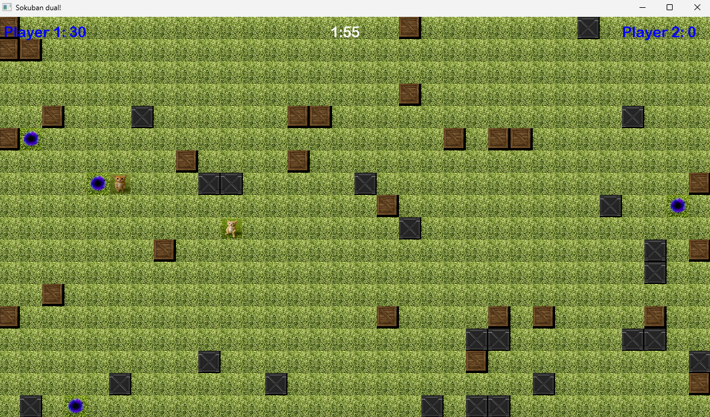

# OOP final project: Sokoban game
**Class: 24C06**

**Members**
- Lê Minh Đức - 24127025
- Đoàn Quốc Bảo - 24127326
- Lê Trần Quang Huy - 24127396 

## Game description
Simple 2-player [Sokoban](https://en.wikipedia.org/wiki/Sokoban) clone as an Object-Oriented Programming course project with AI-assisted coding

One player controls with WASD, another player controls arrow keys. Goal: move the most boxes to the "blackhole" within 2.5 minutes. 



## Source tree
```
<base-directory>/
├── Assets/         # Game asset
├── build_script/   # Build script               
├── include/        # Headers
├── Source/         # Source files
├── SFML/           # SFML
├── Sokoban.exe     # Game executable (after compilation)
├── AI-LOG.md       # A.I. chatbot history log
└── README.md
```

## Compiling the game
### 1. Prerequisite
- A Windows environment, preferably on Windows operating system, or [Wine](https://www.winehq.org/) on Linux/Mac
- C++17-compatible MinGW-gcc compiler for producting the executable (We recommend using Winlibs MinGW-gcc 14.2 or MSYS MinGW-gcc 15.1, as this is the toolchain used in development)

### 2. Compilation
Navigate to `build-script` folder and run `release.bat` file
```
cd build-script
release.bat
```

The game executable is located on the base directory, which can be access by running `../Sokoban.exe` within `build-script` directory

## Dependencies
- SFML 3.0 (included)

## A.I. usage acknowledgement
We used GPT-5 and Deepseek-V3 for this project